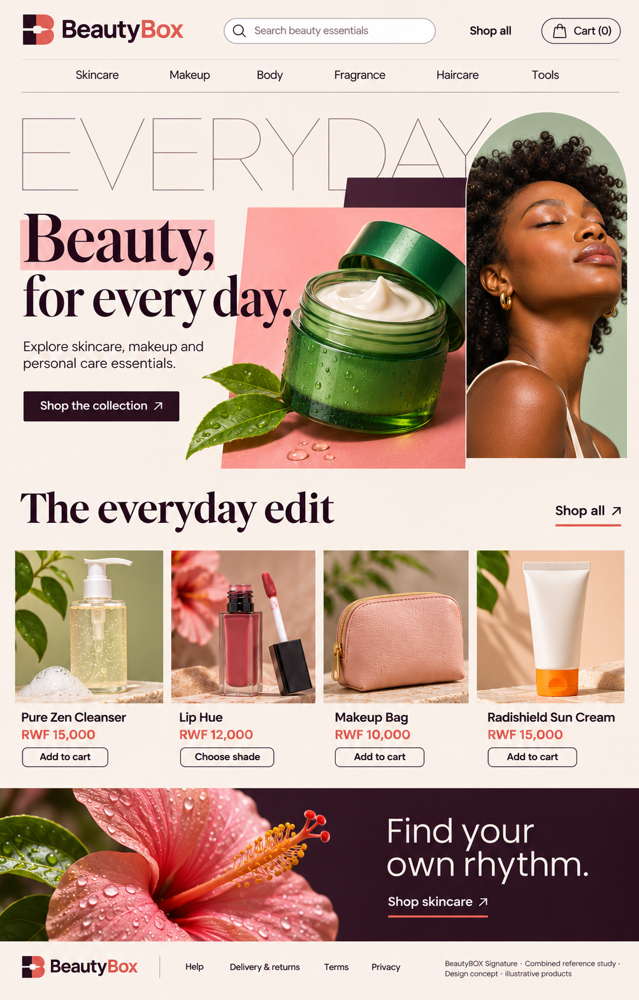
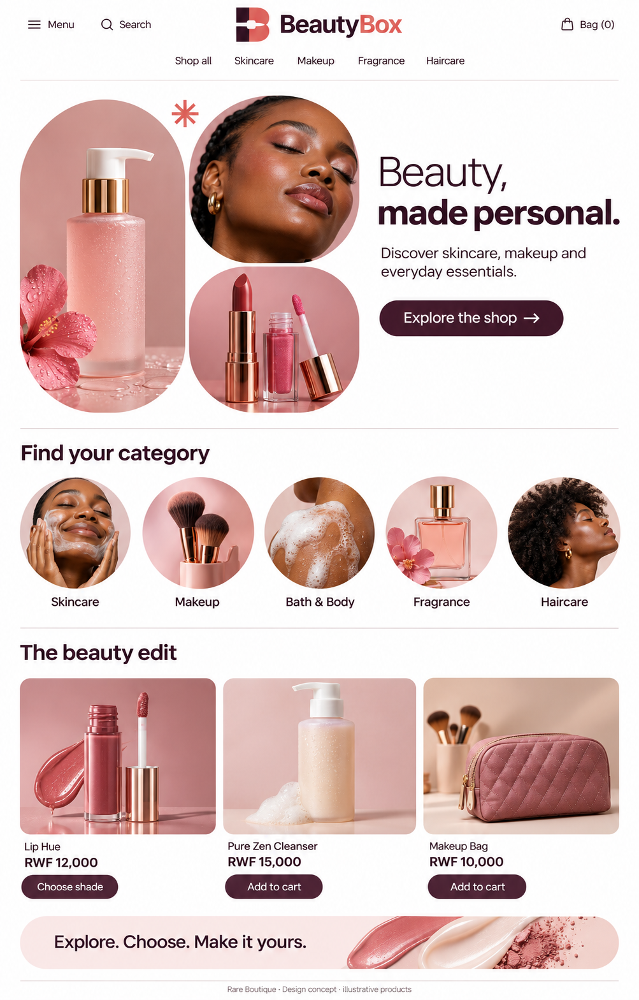
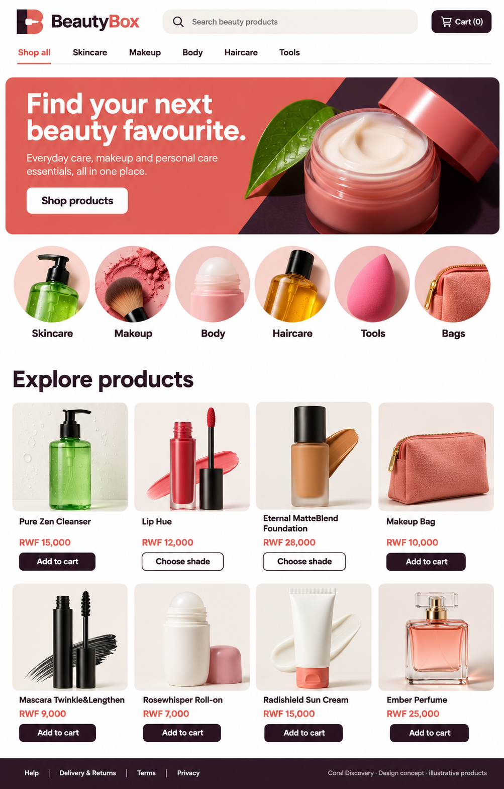

# Recovered BeautyBOX design previews

This checkpoint preserves **14 generated homepage mockups** as directly viewable PNG files. It also records the decisions and remaining work in [the continuation plan](../CONTINUATION-PLAN.md).

**These files are visual references, not the previously discussed application implementation.** The loaded checkout did not contain that later source code, its standalone HTML prototypes, or its recorded test artifacts. No recovered implementation or fresh application-test success is claimed here.

The original archive contained eight reference studies and three combined directions. Three additional generated homepage previews were also recovered. See [the original index](ORIGINAL-REFERENCE-INDEX.md) for the original creation notes and [the hash manifest](recovery-manifest.json) for the recovered image inventory.

Product packaging, copy, claims, photographs and RWF product prices in these generated images are illustrative. They are not approved catalogue content or evidence of real products, discounts, reviews or delivery promises.

## Preview index

Click a name to view the PNG directly on GitHub; no archive download is needed.

| Preview | Kind |
| --- | --- |
| [01-Rive-Gallery](images/01-Rive-Gallery.png) | Reference study |
| [02-BOTANEA-Journal](images/02-BOTANEA-Journal.png) | Reference study |
| [03-Beauties-Colour](images/03-Beauties-Colour.png) | Reference study |
| [04-MyShop-Night](images/04-MyShop-Night.png) | Reference study |
| [05-SORA-Graphic](images/05-SORA-Graphic.png) | Reference study |
| [06-Rare-Boutique](images/06-Rare-Boutique.png) | Reference study |
| [07-Soft-Glow](images/07-Soft-Glow.png) | Reference study |
| [08-Coral-Discovery](images/08-Coral-Discovery.png) | Reference study |
| [09-Graphic-Ritual](images/09-Graphic-Ritual.png) | Combined direction |
| [10-Colour-Boutique](images/10-Colour-Boutique.png) | Combined direction |
| [11-BeautyBOX-Signature](images/11-BeautyBOX-Signature.png) | Combined direction |
| [12-Everyday-Essentials](images/12-Everyday-Essentials.png) | Additional recovered preview |
| [13-Compact-Catalog](images/13-Compact-Catalog.png) | Additional recovered preview |
| [14-Editorial-Collection](images/14-Editorial-Collection.png) | Additional recovered preview |

## Directions discussed for further development

The Signature, Rare Boutique, Beauties Colour and Coral Discovery studies were selected in the conversation for further exploration. The later product/shade/cart reference supplied in chat adds a large product gallery, explicit shade confirmation, and an editable mobile cart. Those later reference images and the final implemented UI are not present in this recovered file set.

### Signature homepage reference

### Boutique homepage reference

### Catalogue homepage reference

